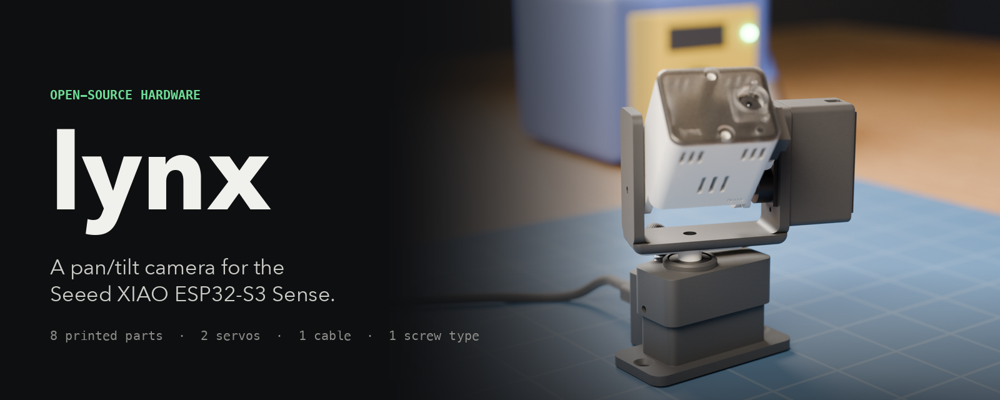
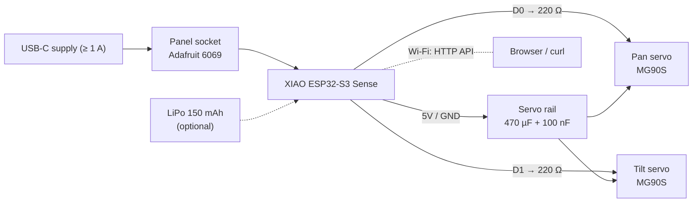
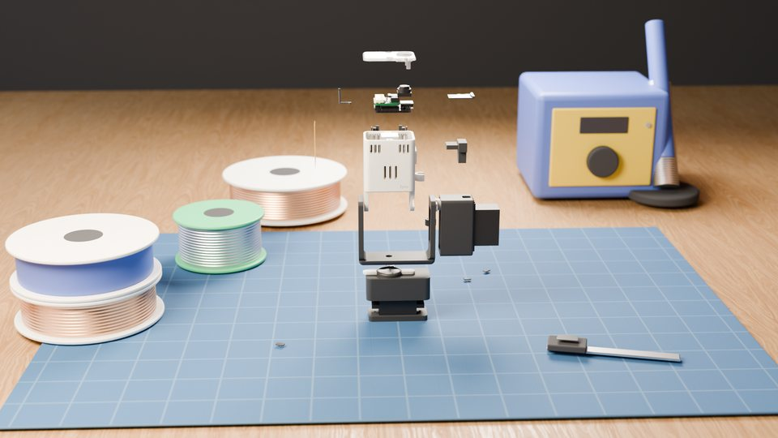
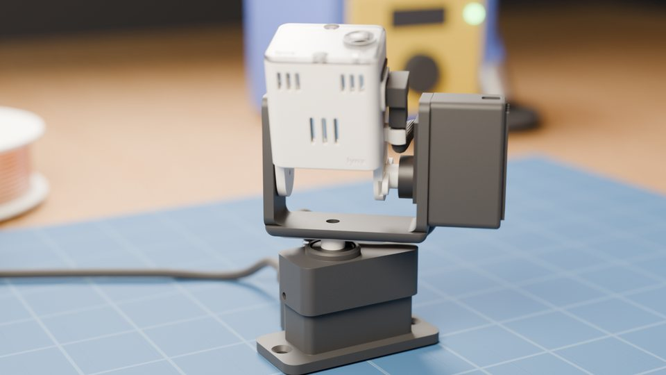
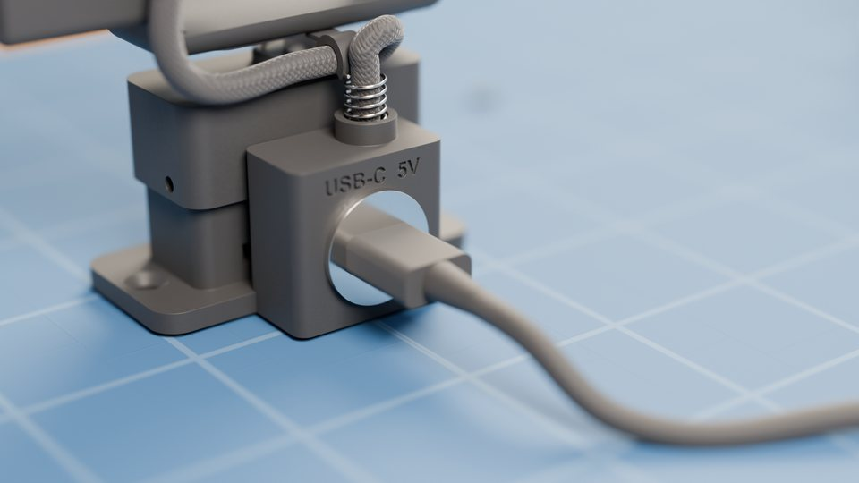
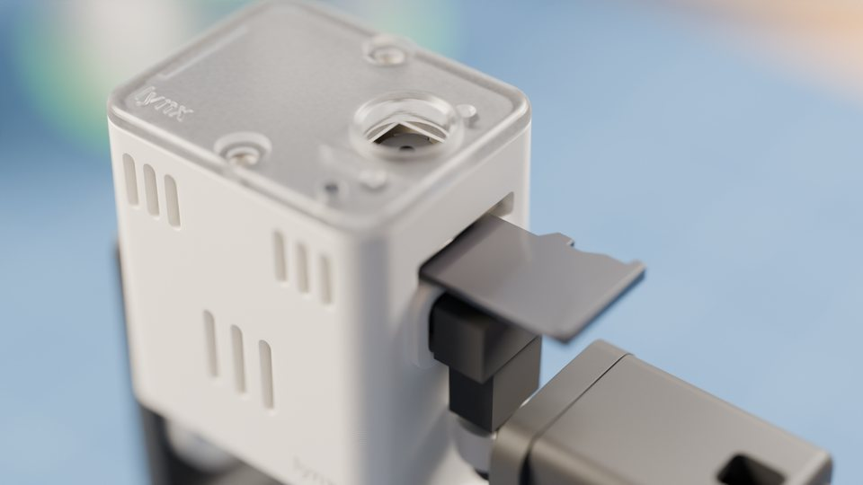
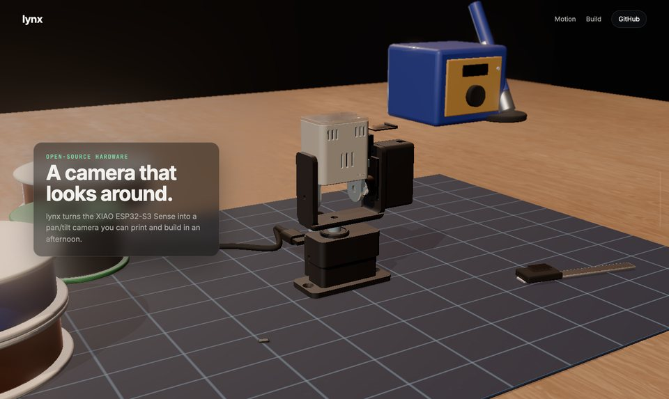
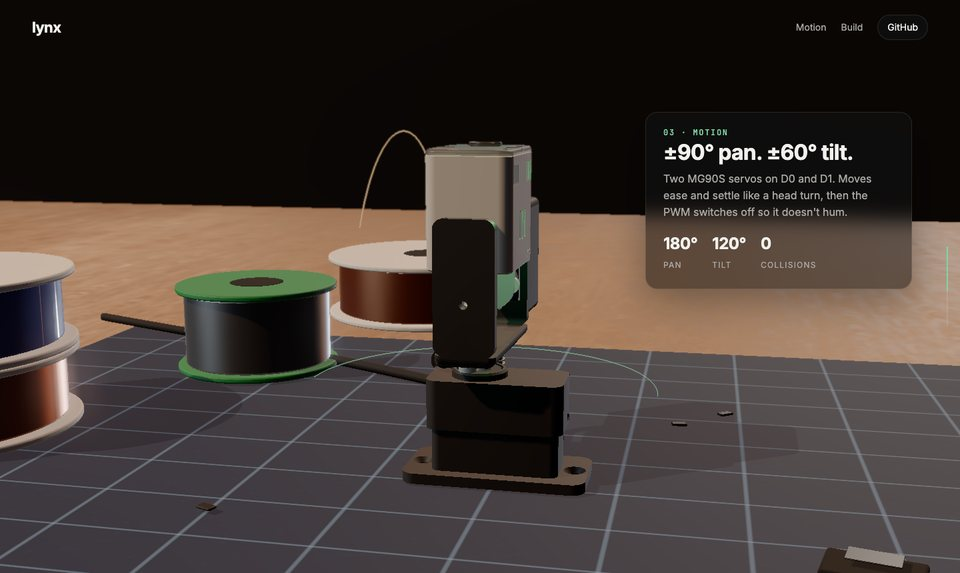

<p align="center">
  
</p>

<p align="center">
  <a href="https://github.com/alexnodeland/lynx/actions/workflows/pages.yml"></a>
  <a href="https://alexnodeland.github.io/lynx/"></a>
  
  <a href="https://github.com/alexnodeland/lynx/actions/workflows/firmware.yml"></a>
  <a href="custom_components/lynx"></a>
  <a href="firmware/lynx#mcp"></a>
  <a href="firmware/lynx"></a>
  <a href="web"></a>
  <br>
  <a href="LICENSES/CERN-OHL-S-2.0.txt"></a>
  <a href="LICENSES/MIT.txt"></a>
  <a href="LICENSES/CC-BY-SA-4.0.txt"></a>
</p>

# lynx

An open-source pan/tilt camera built around the Seeed XIAO ESP32-S3 Sense. It has eight 3D-printed parts and two MG90S servos, runs on one USB-C cable, and is held together by one screw type (M2 × 8 thread-forming).

**Site:** https://alexnodeland.github.io/lynx/ · **[Build guide (3D)](https://alexnodeland.github.io/lynx/build.html)** · **[Web flasher](https://alexnodeland.github.io/lynx/flash.html)** · **[Docs](docs/README.md)**

| Path | Contents |
|------|----------|
| [`hardware/production`](hardware/production) | Print-ready STL/STEP, assembly STEP, [BOM](hardware/production/BOM.md) |
| [`hardware/electronics`](hardware/electronics) | Circuit, nets, parts, wiring harness (servo-carrier PCB in progress) |
| [`custom_components/lynx`](custom_components/lynx) | Home Assistant integration (HACS): auto-discovered, camera + live view, pan/tilt, `lynx.look` action |
| [`firmware/lynx`](firmware/lynx) | PlatformIO firmware: eased pan/tilt, camera snapshots + MJPEG stream, REST API, MCP server, setup hotspot, per-device token |
| [`web`](web) | three.js landing page (Vite + GSAP) |
| `media` | Renders and screenshots |

## Specs

| | |
|---|---|
| Controller | Seeed XIAO ESP32-S3 Sense (camera, microSD, Wi-Fi) |
| Actuators | 2 × MG90S micro servo — pan on D0 (GPIO1), tilt on D1 (GPIO2), 220 Ω series resistors |
| Travel | pan ±90°, tilt ±60° mechanical; firmware soft limits pan ±88°, tilt ±58° |
| Motion | eased "glance" moves, default max speed 300 °/s, PWM detached when idle |
| Power + data | one USB-C cable via a panel socket in the base (Adafruit 6069); supply ≥ 1 A |
| Decoupling | 470 µF 6.3 V bulk + 100 nF across the servo 5 V rail |
| Fasteners | 9 × M2 × 8 thread-forming, pan head — the only screw |
| Printed parts | 8 (base, lid, battery tray, yoke, pan base, pan cap, servo shroud, light pipe) |
| Control | on your network: REST API, MCP server for AI agents, MJPEG stream (port 81), dashboard; per-device token; serial console |
| Setup | first-boot Wi-Fi hotspot `lynx-xxxx` with a captive setup page; `lynx-xxxx.local` via mDNS |
| Detection | on-device faces or cat faces (ESP-DL), ~4 fps; **follow mode** keeps the nearest face in frame; nothing leaves the device |
| Rest pose | pan 0°, tilt 45°: the lens leans toward the front (tilt 0° points it straight up) |
| Battery | optional 150 mAh LiPo keeps the camera up; servos run on USB power only |

## System



## Gallery

| | |
|---|---|
|  |  |
| Exploded: eight parts, one screw type | Assembled on the pan base |
|  |  |
| One USB-C cable into the base | microSD slot above the USB-C port |
|  |  |
| The landing page | Its motion section |

## Parts

Full list with suppliers in [`hardware/production/BOM.md`](hardware/production/BOM.md).

| Qty | Part |
|---|---|
| 8 | printed parts (`hardware/production/*.stl`) |
| 1 | Seeed XIAO ESP32-S3 Sense |
| 2 | MG90S micro servo (Waveshare 15024) or Adafruit SG92R |
| 1 | panel-mount USB-C extension, Adafruit 6069 |
| 1 | right-angle USB-C to USB-C, thin, data-capable, 15–20 cm |
| 1 | 470 µF 6.3 V electrolytic (Panasonic EEU-FR0J471) + 100 nF 0603 |
| 2 | 220 Ω resistor |
| 9 | M2 × 8 thread-forming screw, pan head |
| 1 | 12.7 × 3.17 mm N42 disc magnet (K&J D82) |
| — | optional: 150 mAh LiPo (Adafruit 1317), microSD card |

## Quick start

### 1. Print

Print the three `test-*.stl` fit coupons first, then the eight parts in [`hardware/production`](hardware/production). Orientation, supports and materials per part are in the [BOM](hardware/production/BOM.md#printed-parts); defaults are 0.2 mm layers and 3 walls.

### 2. Assemble

The **[interactive build guide](https://alexnodeland.github.io/lynx/build.html)** walks all 13 steps in 3D:
parts fly in, the rest of the camera stays ghosted, and you can orbit the model at every step. The same steps as text:

Follow the ten steps in the [BOM's assembly section](hardware/production/BOM.md#assembly). Wire the servos as in [`hardware/electronics`](hardware/electronics) — carrier PCB or soldered harness, same nets.

### 3. Flash

The easiest way is from a browser: open the [web flasher](https://alexnodeland.github.io/lynx/flash.html) in Chrome or Edge, plug in over USB-C, and click Install. Or with PlatformIO:

```sh
cd firmware/lynx
pio run -e xiao -t upload       # build and flash over USB-C
pio device monitor -b 115200    # serial console: try `info`, `center`, `sweep`
```

Calibrate before fixing the horns: see [`firmware/lynx`](firmware/lynx#calibration).

### 4. Connect

On first boot lynx opens a Wi-Fi hotspot, **`lynx-xxxx`**. Join it from a phone, pick your network, and save the token the setup page shows. Then open `http://lynx-xxxx.local/` for the live view and controls, or hook up an AI agent:

```sh
claude mcp add --transport http lynx http://lynx-xxxx.local/mcp --header "Authorization: Bearer <token>"
```

The full API and MCP tool list are in [`firmware/lynx`](firmware/lynx#http-api).

**Home Assistant:** add this repo to HACS as a custom integration, restart, and lynx shows up under *Discovered*. Paste the token and you're done. See [`custom_components/lynx`](custom_components/lynx).

### 5. Run the site locally

```sh
cd web
npm ci
npm run dev
```

## Develop

```sh
just setup   # once: PlatformIO + HA test harness in .venv, web deps, git hooks
just check   # lint, 67 firmware tests, XIAO build, 20 Home Assistant tests, site build
just         # every other recipe: fw-flash, fw-monitor, web-dev, hass-test, look, snap, mcp-add, release …
```

[Contributing](CONTRIBUTING.md) · [Architecture](docs/architecture.md) · [Troubleshooting](docs/troubleshooting.md) · [Changelog](CHANGELOG.md)

## Licences

- Hardware: CERN-OHL-S-2.0
- Firmware and web: MIT
- Docs and media: CC-BY-SA-4.0

The licence texts are in [`LICENSES/`](LICENSES).
