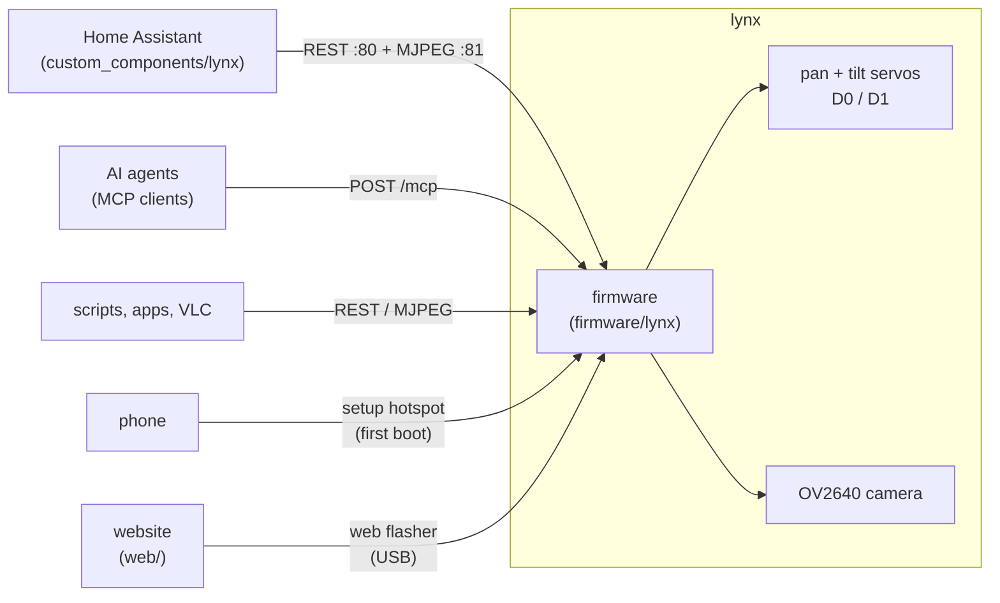
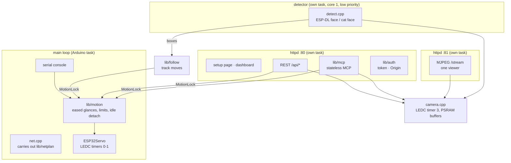
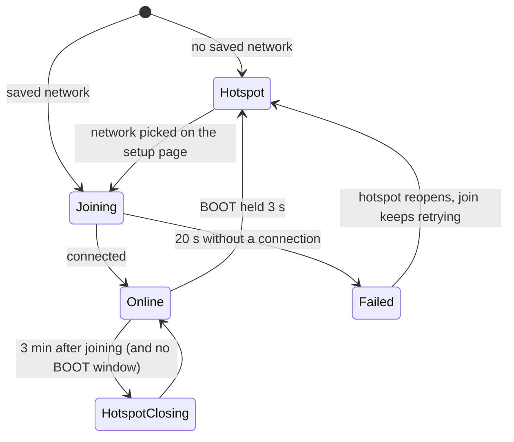
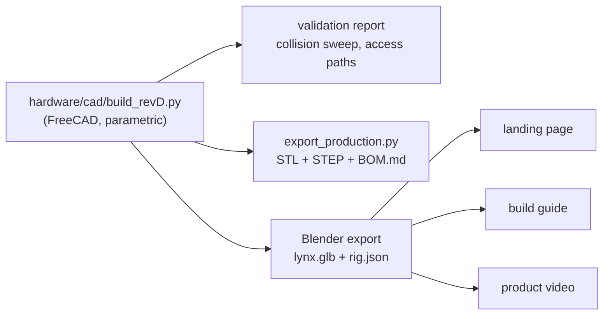

# Architecture

[← docs](README.md)

lynx is four things that share one model: the **hardware** (a FreeCAD script that generates every part),
the **firmware** on the XIAO ESP32-S3 Sense, the **Home Assistant integration**, and the **website**
(landing page, 3D build guide, web flasher). This page shows how they connect.

## The system

Every network call carries the per-device token (`Authorization: Bearer`, or `?token=` on image URLs).
The setup hotspot is the one exception: it's reachable only within radio range, and only while setting up.

## Inside the firmware

- **Pure logic lives in `lib/`** (motion, MCP, auth, network plan, follow). It has no Arduino includes and
  runs as native unit tests on every push: 49 of them.
- **The HTTP servers run in their own FreeRTOS tasks**, so they reach the motion core only through a
  recursive mutex. The stream has its own server, so a viewer can never block a control request.
- **Requests from the HTTP task that change Wi-Fi** (joining from the setup page) are handed to the
  main loop through atomics, so only one task ever drives the Wi-Fi stack.

## First boot to network

These rules are `lib/netplan`, tested over real sequences, including the first-attempt failure seen at bring-up.

## The model is the source of truth

The website's model, part offsets, pivots and cable routes (`rig.json`) all come out of the same
CAD build, so a design change reaches the site, the video and the printed parts together.

## The website

`web/src/stage.js` builds the shared scene: renderer, studio light, the bench, the product with its
pan/tilt rig and per-part holders, cables rebuilt from CAD waypoints, and post-processing. Two pages drive it:

- `main.js`: the landing page, scroll-driven. A damped spring follows the scroll position, so
  wheel steps glide and flicks are capped.
- `build.js`: the build guide, step-driven. Earlier parts sit assembled, the current ones fly in,
  later ones are ghosts. You can orbit the model.

`flash.html` is the web flasher (ESP Web Tools). CI builds the firmware into the site, so the image
it flashes is always the one from that commit.

## CI

| Workflow | Runs |
|---|---|
| `firmware.yml` | native tests, XIAO build, and the release image on `v*` tags |
| `hass.yml` | ruff, 20 integration tests on HA 2026.10, hassfest, the HACS validator |
| `pages.yml` | firmware build, then the site with the flasher image, deployed to GitHub Pages |
| `lint.yml` | the pre-commit hooks |
