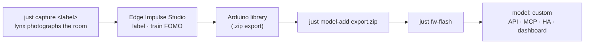

# Custom detection models

[← docs](README.md)

Out of the box lynx detects **faces** and **cat faces** on the board, with ESP-DL models that come with
the toolchain. To detect anything else (a person's whole body, a package on the doorstep, your dog),
train a small model in [Edge Impulse](https://edgeimpulse.com). Install it as lynx's **`custom`** model,
and it appears everywhere the built-in ones do: the API, MCP, Home Assistant and the dashboard.



## 1. Collect images, with lynx

Images from the camera that will run the model work best: same lens, light and room.

```sh
export LYNX_HOST=lynx-42e0.local LYNX_TOKEN=…
just capture package 60        # pans and tilts over the room, one snapshot per stop → datasets/package/
```

Run it a few times: at different times of day, with the object in different places, and **with it
absent** too (FOMO needs background). Aim for 100–300 images.

## 2. Label and train in Edge Impulse

1. Create a project (the free tier is enough). Name it something short, like `lynx-package`.
2. **Data acquisition › Upload** the `datasets/` images (or `npx edge-impulse-uploader datasets/package/*.jpg`),
   then draw a box around each object in the labelling queue.
3. **Create impulse:** image data **96 × 96**, resize mode *squash*, an **Image** block (RGB), then
   **Object detection** with **FOMO (MobileNetV2 0.35)**.
4. Train. FOMO reports F1 per class; 0.8+ is a good start.
5. **Deployment:** *Arduino library*, quantized (int8). Download the `.zip`.

An image-*classification* project works too. lynx then reports its winning label for the whole frame
(when the model is at least 60 % sure) instead of boxes.

## 3. Install it in the firmware

```sh
just model-add ~/Downloads/lynx-package-arduino-1.0.1.zip
just fw-flash
curl -X POST -H "Authorization: Bearer $LYNX_TOKEN" http://$LYNX_HOST/api/detect -d '{"enabled":true,"model":"custom"}'
```

`model-add` unpacks the export into `firmware/lynx/lib/lynx_model/` (git-ignored: commit it on purpose if
you want to ship it) and writes a shim header, so the firmware doesn't need to know the project's name.
`just model-remove` takes it out again. The firmware builds the same with or without a model.

Test it on photos before pointing the camera at anything:

```sh
curl -X POST -H "Authorization: Bearer $LYNX_TOKEN" --data-binary @photo.jpg "http://$LYNX_HOST/api/detect/image"
```

## What it costs

Measured on the board with Seeed's public Edge Impulse export for the XIAO ESP32-S3 (a 96 × 96, 3-class
image classifier). CI builds the firmware with that same export, so the adapter can't quietly break.

| | |
|---|---|
| Flash | +0.72 MB (2.47 of the 3.34 MB app slot) |
| Static RAM | +37 KB |
| Speed | ~1.5 frames/s for that classifier. FOMO models are usually smaller and faster |

Edge Impulse's exports include ESP-NN's C kernels but not its ESP32-S3 assembly. `model-add` switches
ESP-NN to its optimised-C path, which was 3× faster than without it (2.1 s → 0.66 s per frame).

## Planned

- A **person** (whole-body) FOMO model, so follow mode can track you when you're facing away.
  It needs an Edge Impulse project: clone a public person-detection project or train one from `just capture` shots.
- Following custom classes: follow mode works on faces today; it will follow any box once a model provides them.
