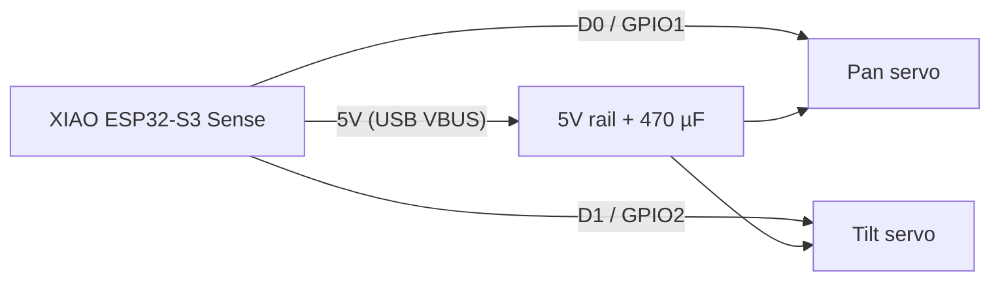
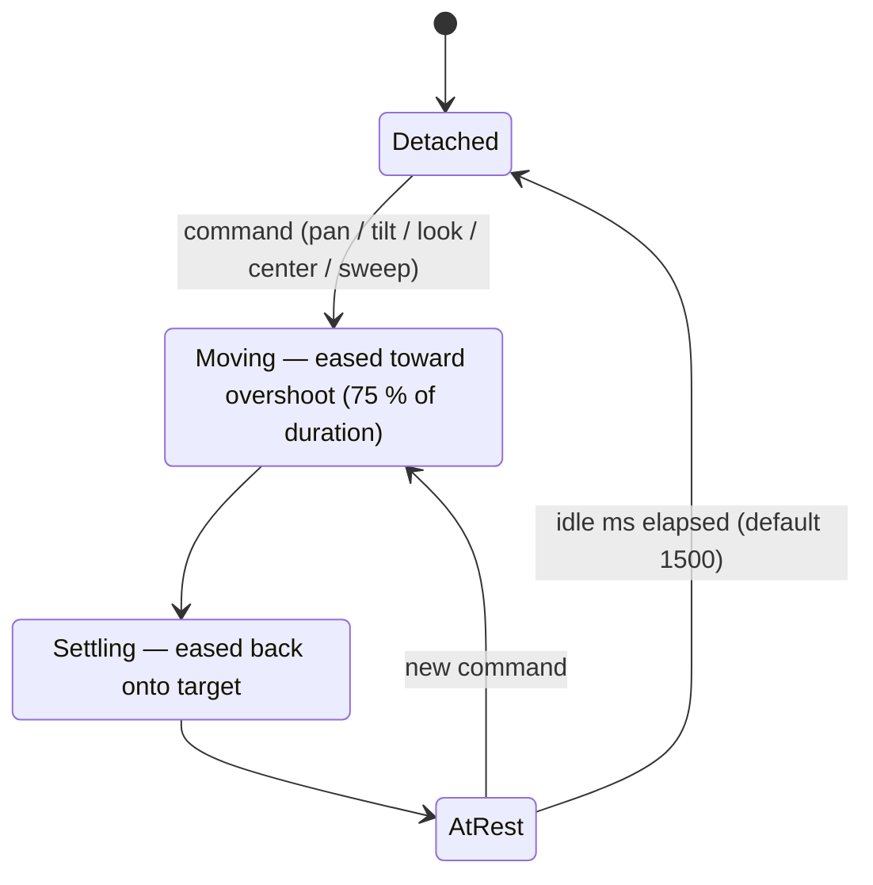

# lynx-motion

[](platformio.ini)
[](platformio.ini)
[](../../LICENSES/MIT.txt)

Motor-control firmware for **lynx**, the open-source pan/tilt camera on a
Seeed Studio XIAO ESP32-S3 Sense. Motion only — no camera streaming yet.

## Wiring



| From | To |
|------|----|
| Pan servo signal (orange/yellow) | XIAO **D0** (GPIO1) |
| Tilt servo signal | XIAO **D1** (GPIO2) |
| Both servo V+ (red) | XIAO **5V** pin (USB VBUS) |
| Both servo GND (brown) | XIAO **GND** |
| 470 µF electrolytic | across 5V–GND, close to the servo connectors, **− to GND** |

Servos run from USB VBUS only; on battery they are unpowered (the 5V pin is
not boosted), so the head will not move on battery.

> **Safety / current:** an MG90S/SG90 draws ~0.7–1 A at stall *each*, and both
> can stall together at a hard stop or under load. Use a USB supply rated
> **≥ 1 A** (2 A is comfortable). A weak port or long thin cable will brown out
> the ESP32 (resets, Wi-Fi drops). Don't let a servo push against a mechanical
> stop — that is why the soft limits sit 2° inside the CAD limits and why PWM
> detaches when idle.

## Build and flash

PlatformIO, Arduino framework, board id `seeed_xiao_esp32s3` (present in the
pinned `espressif32@6.9.0` platform).

```sh
pio run -e xiao                 # build
pio run -e xiao -t upload       # flash over USB-C
pio device monitor -b 115200    # serial console
pio test -e native              # motion-core unit tests on the host
```

If upload doesn't find the board, hold **BOOT**, tap **RESET**, release BOOT,
and upload again.

## Layout

- `lib/motion/` — the hardware-independent motion core (targets, glance easing,
  speed limit, soft-limit clamping, idle detach, sweep sequencer). No Arduino
  includes; compiled both for the board and for `env:native` tests.
- `src/main.cpp` — servo PWM, serial commands, Wi-Fi, HTTP API.
- `src/settings.*` — NVS (Preferences, namespace `lynx`).
- `src/page.h` — the embedded control page.
- `test/test_motion/` — Unity tests.

**Why ESP32Servo rather than raw LEDC:** the LEDC API changed between
arduino-esp32 2.x (`ledcSetup`/`ledcAttachPin`) and 3.x (`ledcAttach`);
ESP32Servo (pinned 3.0.6) hides that, handles timer/channel allocation and
microsecond writes, and has `detach()` to stop the pulse train. The motion core
only produces a pulse width, so swapping to raw LEDC later touches only
`driveServos()`.

## Motion



Every move uses a "glance" profile: ease-in-out up to a small overshoot
(6 % of the distance, capped at 4°) at 75 % of the duration, then an eased
settle back onto the target — no wind-up at the start, like a head turn.
Duration is `180 ms + 4 ms/°` unless given; either way it is stretched so the
peak speed never exceeds `speed` (default 300 °/s). Targets and the overshoot
itself are clamped to the soft limits. Both axes of a `look` share one
duration so they arrive together. After `idle` ms at rest (default 1500) the
PWM is detached so the servos stop humming/jittering; the next move reattaches.
Everything runs from `loop()` on `millis()` (wrap-safe) — no blocking delays.

## Calibration

Defaults: 500–2500 µs at 50 Hz, centre 1500 µs, 11.11 µs/°, soft limits
pan ±88°, tilt ±58°. All of it is per axis and persisted by `save`.

1. Remove the horn or keep the head clear, power over USB, open the monitor.
2. `center`. Fit the horn so the head points straight ahead/level.
3. Fine-tune with `trim pan 1520`, `trim tilt 1480` … until it is exactly centred.
4. `pan 45`: if it went the wrong way, `invert pan`. Same for tilt.
5. Check scale: `pan 88` and `pan -88` should land just short of the stops
   symmetric about centre. If the swing is short/long, adjust
   `usperdeg pan <µs>` (servos vary 9.5–11.5).
6. If needed, narrow travel: `limits tilt -45 50`.
7. `save`. Check with `status`.

Settings changes take effect at once but are lost on reset until `save`.

## Serial commands (115200 baud, newline-terminated)

| Command | Effect |
|---------|--------|
| `pan <deg>` / `tilt <deg>` | move one axis |
| `look <pan> <tilt> [ms]` | move both, optional duration |
| `center` | go to 0, 0 |
| `sweep` | demo: pan ends, tilt ends, four corners, home |
| `limits` | print soft limits |
| `limits <axis> <min> <max>` | set soft limits (bounded by mechanical ±90 / ±60) |
| `trim <axis> <us>` | centre pulse width |
| `usperdeg <axis> <us>` | pulse per degree |
| `invert <axis>` | toggle direction |
| `speed <deg/s>` | max speed (10–600) |
| `idle <ms>` | idle-detach time, `0` = never detach |
| `wifi <ssid> <pass>` | save Wi-Fi credentials to NVS and connect |
| `save` | persist calibration/limits/speed/idle |
| `status` | JSON status |
| `help` | list commands |

`<axis>` is `pan`/`p` or `tilt`/`t`.

## Wi-Fi and HTTP API

With saved credentials it joins that network as `lynx`; if it isn't connected
within 15 s (or no credentials are saved) it also opens an **open** SoftAP
`lynx-setup` (`http://192.168.4.1/`). Credentials are set over serial only.
The AP and API are unauthenticated — fine on a bench, not on an untrusted
network.

| Request | Body | Effect |
|---------|------|--------|
| `GET /` | | control page: two sliders, Centre, Sweep |
| `GET /api/status` | | positions, targets, pulse, attached, limits, Wi-Fi |
| `POST /api/look` | `{"pan":30,"tilt":-10,"ms":600}` (all optional) | move |
| `POST /api/center` | | centre |
| `POST /api/sweep` | | demo sweep |

```sh
curl -X POST http://<lynx-ip>/api/look -d '{"pan":40,"tilt":10}'
```

All POSTs answer with the status JSON.

## License

MIT — see `LICENSES/MIT.txt` at the repo root. Each source file carries
`SPDX-License-Identifier: MIT`.
