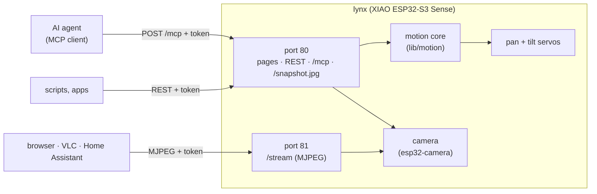
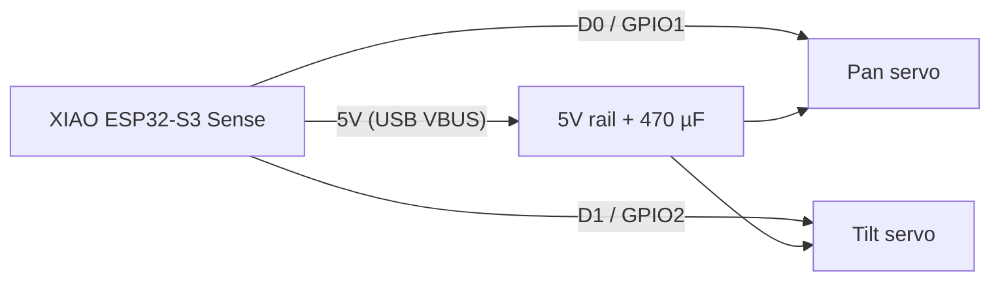
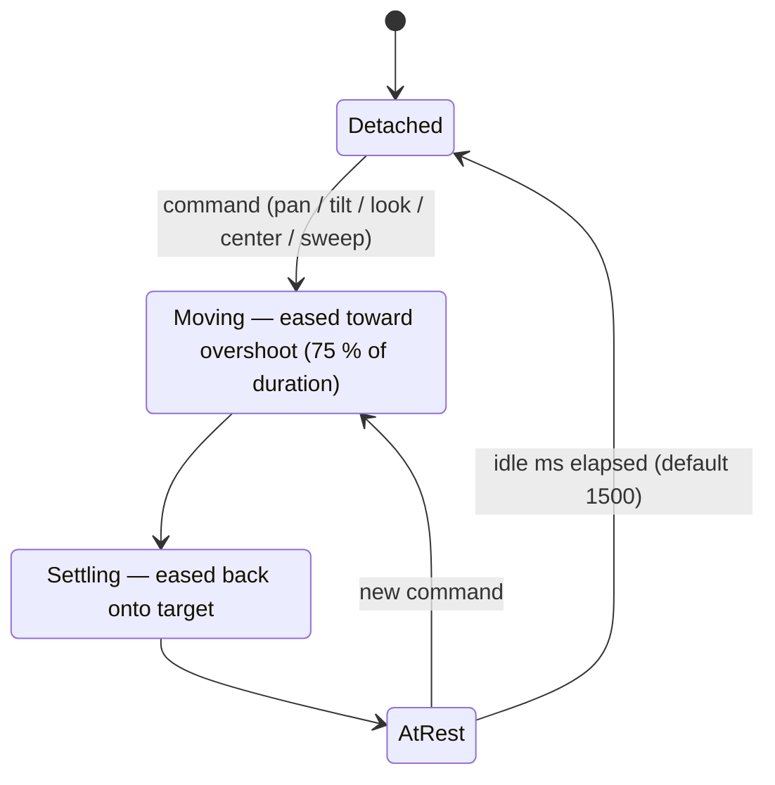

# lynx firmware

[](https://github.com/alexnodeland/lynx/actions/workflows/firmware.yml)
[](#mcp)
[](platformio.ini)
[](platformio.ini)
[](../../LICENSES/MIT.txt)

Firmware for **lynx**, the open-source pan/tilt camera on a Seeed Studio XIAO
ESP32-S3 Sense. One image runs the whole product:

- **Servos:** eased pan/tilt motion with soft limits, resting at tilt 45° (lens leaning toward the front).
- **Camera:** JPEG snapshots and an MJPEG live stream.
- **Control layer on your network:** a REST API, an **MCP server** for AI agents, and a small dashboard.
- **Setup:** a first-boot Wi-Fi hotspot with a captive setup page.

Every API call needs a per-device token.

**Install from a browser:** [alexnodeland.github.io/lynx/flash.html](https://alexnodeland.github.io/lynx/flash.html)
(Chrome or Edge, USB-C). Or build it yourself, below.

> **Status:** first bring-up on a XIAO ESP32-S3 Sense done on 2026-10-20 (no servos attached).
> These are verified: boot, camera and PSRAM, the captive setup page popping up on a phone, the join,
> mDNS from macOS, the hotspot closing, REST, MCP (both protocol generations, the Origin guard,
> token checks, snapshot images) and the MJPEG stream. Still open: servos under load, brownout,
> `claude mcp add` end to end, and the web flasher. 39 native tests (motion, MCP, auth, network plan) run in CI.

## How it fits together



## Setup (first boot)

```mermaid
sequenceDiagram
  participant P as Phone
  participant L as lynx
  participant W as Home Wi-Fi
  L->>L: first boot: no network saved
  L-->>P: opens hotspot "lynx-xxxx"
  P->>L: joins it; captive page opens
  P->>L: picks network + password
  L->>W: joins
  L-->>P: "online at lynx-xxxx.local" + device token
  Note over L: hotspot closes 3 min later
```

1. Power lynx on. With no saved network it opens an open Wi-Fi hotspot named
   **`lynx-xxxx`** (the last four hex digits of its MAC address, so two units don't collide).
2. Join it from a phone. The setup page opens by itself; if it doesn't, browse to `http://192.168.4.1/`.
3. Pick your network (2.4 GHz) and type its password. The page then shows the
   device's address (`http://lynx-xxxx.local/`) and its **token**. Save the token.
4. Reconnect the phone to your own Wi-Fi and open the address. The dashboard asks for
   the token once, then shows the live view, controls, and copy-paste snippets for MCP and curl.

To get back into setup (new network, lost token), **hold the BOOT button for 3 s**.
The hotspot reopens for 10 minutes. If lynx can't reach its saved network for 20 s,
it reopens the hotspot by itself and keeps retrying the network.

## Wiring



| From | To |
|------|----|
| Pan servo signal (orange/yellow) | XIAO **D0** (GPIO1) |
| Tilt servo signal | XIAO **D1** (GPIO2) |
| Both servo V+ (red) | XIAO **5V** pin (USB VBUS) |
| Both servo GND (brown) | XIAO **GND** |
| 470 µF electrolytic | across 5V–GND, close to the servo connectors, **− to GND** |

Servos run from USB VBUS only; on battery they are unpowered (the 5V pin is
not boosted), so the head will not move on battery.

> **Safety / current:** an MG90S/SG90 draws ~0.7–1 A at stall *each*, and both
> can stall together at a hard stop or under load. Use a USB supply rated
> **≥ 1 A** (2 A is comfortable). A weak port or long thin cable will brown out
> the ESP32 (resets, Wi-Fi drops). Don't let a servo push against a mechanical
> stop — that is why the soft limits sit 2° inside the CAD limits and why PWM
> detaches when idle.

## Build and flash

PlatformIO, Arduino framework, board id `seeed_xiao_esp32s3` (present in the
pinned `espressif32@6.9.0` platform).

```sh
pio run -e xiao                 # build
pio run -e xiao -t upload       # flash over USB-C
pio device monitor -b 115200    # serial console
pio test -e native              # motion, MCP and auth unit tests on the host
```

If upload doesn't find the board, hold **BOOT**, tap **RESET**, release BOOT,
and upload again.

## Layout

Pure logic lives in `lib/`. It has no Arduino includes, builds for the board and for
`env:native`, and is unit-tested there. Hardware glue lives in `src/`.

| Path | What |
|------|------|
| `lib/motion/` | motion core: targets, glance easing, speed limit, soft limits, idle detach, sweep |
| `lib/mcp/` | stateless MCP server (tools only) over a `Device` interface |
| `lib/auth/` | token generation and constant-time check, Bearer / `?token=` parsing, Origin guard |
| `src/main.cpp` | servo PWM, serial console, status JSON, the motion lock |
| `lib/netplan/` | when the setup hotspot opens and closes, and the join state: pure rules, unit-tested |
| `src/net.*` | carries out the netplan: hotspot + captive DNS, station mode, mDNS (with IPv6), BOOT button |
| `src/web.*` | `esp_http_server`: port 80 (pages, REST, MCP, snapshot), port 81 (stream) |
| `src/camera.*` | esp32-camera on the XIAO Sense pins |
| `src/pages.h` | setup page, dashboard, shared CSS (no external assets) |
| `src/settings.*` | NVS (Preferences, namespace `lynx`): calibration, Wi-Fi, token, camera |
| `tools/merge_bin.py` | post-build: `lynx.bin`, one image to flash at 0x0 (used by the web flasher) |
| `test/` | Unity tests: `test_motion`, `test_mcp`, `test_auth`, `test_netplan` |

The HTTP servers run in their own FreeRTOS tasks, so every touch of the motion
core goes through a recursive mutex (`MotionLock`). The stream gets its own server
on port 81, so a viewer can never block a control request. The servos own LEDC
timers 0 and 1 (ESP32Servo explicit allocation), and the camera clock uses timer 3,
channel 7, so they never collide.

**Why ESP32Servo rather than raw LEDC:** the LEDC API changed between
arduino-esp32 2.x (`ledcSetup`/`ledcAttachPin`) and 3.x (`ledcAttach`);
ESP32Servo (pinned 3.0.6) hides that, handles timer/channel allocation and
microsecond writes, and has `detach()` to stop the pulse train. The motion core
only produces a pulse width, so swapping to raw LEDC later touches only
`driveServos()`.

## Motion



Every move uses a "glance" profile: ease-in-out up to a small overshoot
(6 % of the distance, capped at 4°) at 75 % of the duration, then an eased
settle back onto the target — no wind-up at the start, like a head turn.
Duration is `180 ms + 4 ms/°` unless given; either way it is stretched so the
peak speed never exceeds `speed` (default 300 °/s). Targets and the overshoot
itself are clamped to the soft limits. Both axes of a `look` share one
duration so they arrive together. After `idle` ms at rest (default 1500) the
PWM is detached so the servos stop humming/jittering; the next move reattaches.
Everything runs from `loop()` on `millis()` (wrap-safe) — no blocking delays.

## Calibration

Defaults: 500–2500 µs at 50 Hz, centre 1500 µs, 11.11 µs/°, soft limits
pan ±88°, tilt ±58°. All of it is per axis and persisted by `save`.

1. Remove the horn or keep the head clear, power over USB, open the monitor.
2. `look 0 0` (pan centred, **lens pointing straight up**). Fit the horns so the head
   faces straight ahead and the lens points at the ceiling. (`center` then rests it at tilt 45°.)
3. Fine-tune with `trim pan 1520`, `trim tilt 1480` … until it is exactly centred.
4. `pan 45` should turn the head to its left. `tilt 45` must lean the lens toward the
   **front**. If either goes the wrong way, run `invert pan` / `invert tilt`.
5. Check scale: `pan 88` and `pan -88` should land just short of the stops
   symmetric about centre. If the swing is short/long, adjust
   `usperdeg pan <µs>` (servos vary 9.5–11.5).
6. If needed, narrow travel: `limits tilt -45 50`.
7. `save`. Check with `status`.

Settings changes take effect at once but are lost on reset until `save`.

## Serial commands (115200 baud, newline-terminated)

| Command | Effect |
|---------|--------|
| `pan <deg>` / `tilt <deg>` | move one axis |
| `look <pan> <tilt> [ms]` | move both, optional duration |
| `center` | rest pose: pan 0, tilt 45 |
| `sweep` | demo: pan ends, tilt ends, four corners, home |
| `limits` | print soft limits |
| `limits <axis> <min> <max>` | set soft limits (bounded by mechanical ±90 / ±60) |
| `trim <axis> <us>` | centre pulse width |
| `usperdeg <axis> <us>` | pulse per degree |
| `invert <axis>` | toggle direction |
| `speed <deg/s>` | max speed (10–600) |
| `idle <ms>` | idle-detach time, `0` = never detach |
| `wifi <ssid> <pass>` | save Wi-Fi credentials to NVS and connect |
| `setup` | reopen the setup hotspot for 10 minutes |
| `token` | print the API token |
| `token new` | mint a new token (the old one stops working at once) |
| `info` | name, address, version, camera state |
| `save` | persist calibration/limits/speed/idle |
| `status` | JSON status |
| `help` | list commands |

`<axis>` is `pan`/`p` or `tilt`/`t`.

## HTTP API

Base URL `http://lynx-xxxx.local/` (or its IP). Every call needs the token:
`Authorization: Bearer <token>`. `?token=<token>` also works, which is what lets
image and stream URLs go straight into an ``, VLC or Home Assistant.

| Request | Body | Effect |
|---------|------|--------|
| `GET /api/info` | | name, version, endpoint list. **No token needed**, no secrets |
| `GET /api/status` | | angles, targets, pulse, limits, camera, network, heap |
| `POST /api/position` | `{"pan":30,"tilt":45,"ms":600}` (all optional) | move; answers with status |
| `POST /api/center` | | rest pose (pan 0, tilt 45) |
| `POST /api/sweep` | | demo sweep |
| `GET /api/camera` | | camera settings |
| `POST /api/camera` | `{"framesize":"SVGA","quality":10,"vflip":false,"hmirror":false,"brightness":0}` | change any of them (saved) |
| `GET /snapshot.jpg` | | one JPEG frame |
| `GET :81/stream` | `?fps=10` optional | MJPEG live video, **one viewer at a time** (a second gets `503`) |
| `POST /mcp` | JSON-RPC | MCP, below |

```sh
TOKEN=...   # from the setup page, or the serial `token` command
curl -X POST http://lynx-1a2b.local/api/position -H "Authorization: Bearer $TOKEN" -d '{"pan":40,"tilt":45}'
curl -o lynx.jpg "http://lynx-1a2b.local/snapshot.jpg?token=$TOKEN"
ffplay "http://lynx-1a2b.local:81/stream?token=$TOKEN"
```

Frame sizes: `QVGA` 320×240, `VGA` 640×480 (default), `SVGA` 800×600, `XGA`,
`HD`, `SXGA`, `UXGA` 1600×1200. Larger sizes mean fewer frames per second.

## MCP

lynx is an MCP server at `POST /mcp` (Streamable HTTP, JSON responses, tools only, stateless).
It speaks both protocol generations:

- **2026-07-28:** `server/discover`. Every request carries its version in `params._meta`,
  and the `MCP-Protocol-Version` / `Mcp-Method` / `Mcp-Name` headers are checked against the body.
- **2025-11-25, 2025-06-18, 2025-03-26:** the `initialize` handshake. No session ids are minted.

`GET`/`DELETE /mcp` answer `405`: there is no server-to-client stream. A browser
`Origin` must name the device itself (DNS-rebinding guard).

| Tool | Arguments | Returns |
|------|-----------|---------|
| `status` | | the status JSON (also as `structuredContent`) |
| `look` | `pan` −88..88, `tilt` −58..58, `ms` optional | text: where it's moving and how long it takes |
| `center` | | rest pose |
| `sweep` | | demo sweep |
| `snapshot` | | an `image` (base64 JPEG) |
| `stream_url` | | the MJPEG and snapshot URLs: video doesn't travel over MCP |
| `set_camera` | `framesize`, `quality`, `vflip`, `hmirror`, `brightness` | confirmation |

```sh
claude mcp add --transport http lynx http://lynx-1a2b.local/mcp --header "Authorization: Bearer $TOKEN"
```

Any other client takes the same URL and header, e.g.
`{"mcpServers":{"lynx":{"type":"http","url":"http://lynx-1a2b.local/mcp","headers":{"Authorization":"Bearer …"}}}}`.
The dashboard prints both with your token filled in.

### Lessons from bring-up

- **mDNS stalled for 5 s on macOS/iOS.** They ask for an IPv6 address first, and a v4-only ESP32 never
  answers. The firmware now enables an IPv6 link-local address on the station, and lookups take ~5 ms.
- **The setup hotspot stayed open after joining.** The open/close rules moved into `lib/netplan` with
  explicit timestamps instead of a sentinel, and are now unit-tested over the real sequences:
  fresh setup, a failed first attempt, the router coming back, BOOT re-entry, link drops, millis wrap.
  Hardware confirmed the close.
- A first boot used to log one `NOT_FOUND` line per missing setting. Reads now check the key first.
- Every frame black = a dark room, not a fault: the sensor's auto-exposure is fine once there's light.

## Home Assistant

The integration in [`custom_components/lynx`](../../custom_components/lynx) finds lynx through the
`_lynx._tcp` mDNS record (its TXT `id` is the full MAC address, used as the device's unique id) and talks to the API above.

## Security model

- **Token:** 128 random bits from the hardware RNG, minted on first boot and kept in NVS.
  It's required for every endpoint except `/`, `/lynx.css` and `/api/info`, and compared in
  constant time. `token new` on the serial console rotates it.
- **Where the token is shown:** only on the setup hotspot page, to someone within radio
  range during setup, and on the USB serial console. The LAN dashboard never shows it;
  it asks for it.
- **Setup endpoints** (`/setup/*`) answer only on the hotspot interface. The hotspot is open,
  but it's up only on first boot, after BOOT is held, or while the saved network is unreachable.
- **No TLS:** the token crosses your LAN in the clear, like any LAN camera. Don't expose
  lynx to the internet; reach it over a VPN (e.g. Tailscale) if you need remote access.

## Bring-up checklist

None of these can be checked off the board. ✅ = verified at first bring-up (2026-10-20).

1. ✅ **Boot log:** `pio device monitor` prints `lynx 0.3.0 ready as lynx-xxxx` and no `camera:` error.
   `info` → camera ready. `status` → `freePsram` is several MB (PSRAM is detected).
2. **Servos and camera together:** `sweep` while `/stream` is open. Both keep working, with no
   jitter (LEDC timers don't collide) and no resets.
3. **Brownout:** move hard (`look 88 58`, `look -88 -58`) while streaming at UXGA on your USB
   supply. Watch for `Brownout detector` resets. If any, use a 2 A supply or a shorter cable.
4. ✅ (one phone) **Captive portal:** on iOS and Android, joining `lynx-xxxx` pops the setup page by itself.
5. ✅ (macOS) **mDNS:** `ping lynx-xxxx.local` resolves from macOS, Windows and Linux (Android may need the IP).
6. ✅ **Hotspot closes** about 3 minutes after joining, and reopens with BOOT held for 3 s.
7. **MCP:** `claude mcp add …` as above, then ask the agent to "look left and take a snapshot".
8. **Stream:** a second viewer gets `503`; the first keeps streaming; snapshots still work.
9. **Orientation:** if the image is upside down, `POST /api/camera {"vflip":true}` (or `hmirror`).
10. **Web flasher:** flash a blank board from `flash.html` and repeat step 1.

## License

MIT — see `LICENSES/MIT.txt` at the repo root. Each source file carries
`SPDX-License-Identifier: MIT`.
