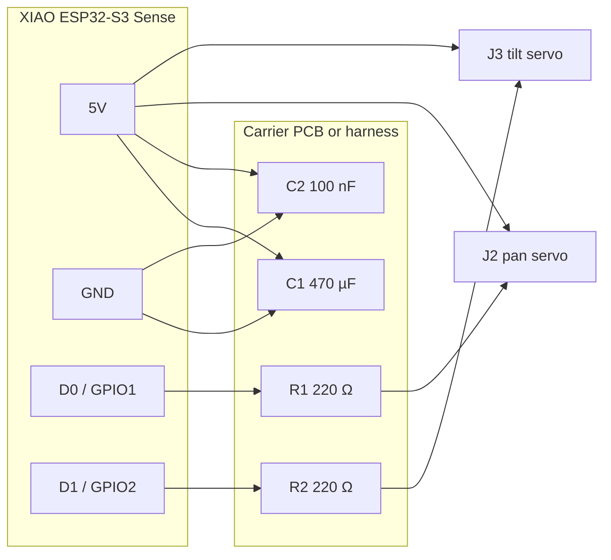
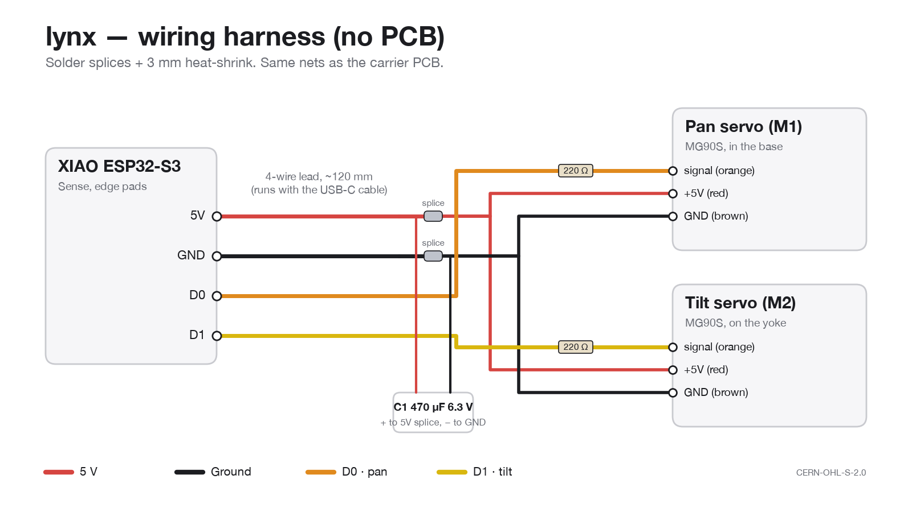

<!-- SPDX-License-Identifier: CERN-OHL-S-2.0 -->
# lynx electronics

[](../../LICENSES/CERN-OHL-S-2.0.txt)
[](#parts-electronics)

lynx has very little electronics of its own: the Seeed XIAO ESP32-S3 Sense does the work, and
two hobby servos move it. What needs designing is how power and the two servo signals get from
the XIAO to the servos. You can build it two ways — both use the same nets.

| Option | What it is | When to choose it |
|---|---|---|
| **A. Carrier PCB** (`lynx-carrier/`) | An 18 × 14 mm, 2-layer board that sits in the power pod: two 3-pin servo headers, the bulk capacitor, series resistors, and a 4-pin lead to the XIAO. | Cleanest build; servos unplug; recommended. |
| **B. Wiring harness** (`harness/`) | The same circuit as soldered splices with heat-shrink, no PCB. | No PCB order; fine for a one-off. |

## Circuit



```text
            XIAO ESP32-S3 Sense                       carrier PCB (in the power pod)
          ┌──────────────────────┐   4-wire lead    ┌──────────────────────────────────┐
  USB-C ──┤ USB-C          5V ●──┼──── red ─────────┤ +5V ──┬──────┬──────────┬────────── │
 (from    │                GND ●─┼──── black ───────┤ GND ──┼──┬───┼──┬───────┼──┬────── │
  base    │                 D0 ●─┼──── orange ──────┤ PAN ─[220R]─┐ │  │       │  │      │
  socket) │                 D1 ●─┼──── yellow ──────┤ TILT ─[220R]┼─┼──┼─┐     │  │      │
          └──────────────────────┘                  │       C1 470µ │ C2 100n │  │      │
                                                    │  J2 PAN  [S + −]   J3 TILT [S + −] │
                                                    └──────────────────────────────────┘
```

| Net | XIAO pad | Carrier | Servo pin | Notes |
|---|---|---|---|---|
| `+5V` | 5V (USB VBUS) | J1-1, J2-2, J3-2, C1+, C2 | red | live only on USB power: on battery the servos stop, the camera keeps running |
| `GND` | GND | J1-2, J2-3, J3-3, C1−, C2 | brown / black | |
| `PAN` | D0 (GPIO1) | J1-3 → R1 220 Ω → J2-1 | orange | series R limits ringing and protects the GPIO |
| `TILT` | D1 (GPIO2) | J1-4 → R2 220 Ω → J3-1 | orange | |

**Why these parts.** An MG90S draws up to ~0.7–1 A at stall. C1 (470 µF, 6.3 V, low-ESR) carries
the inrush when a servo starts so the 5 V rail — and the ESP32 — don't brown out; C2 (100 nF)
takes the high-frequency noise from the servo motors. 3.3 V logic drives SG90/MG90S signal
inputs reliably, so no level shifter is needed. Use a USB supply rated **≥ 1 A**.

## Parts (electronics)

| Ref | Part | Footprint | Orderable as |
|---|---|---|---|
| U1 | Seeed XIAO ESP32-S3 Sense | — (module) | Seeed 113991115 |
| J1 | 4-pin JST-SH 1.0 mm, vertical | JST_SH_SM04B-SRSS-TB | JST SM04B-SRSS-TB + 1.0 mm pre-crimped lead |
| J2, J3 | 3-pin 2.54 mm male header | PinHeader_1x03_P2.54mm_Vertical | any 2.54 mm header strip |
| C1 | 470 µF 6.3 V aluminium, Ø6.3 × 11.2 | CP_Radial_D6.3mm_P2.50mm | Panasonic EEU-FR0J471 |
| C2 | 100 nF 16 V X7R 0603 | C_0603_1608Metric | Samsung CL10B104KO8NNNC |
| R1, R2 | 220 Ω 1 % 0603 | R_0603_1608Metric | Yageo RC0603FR-07220RL |
| M1, M2 | MG90S micro servo | — | Waveshare 15024 |

## Harness (option B)



See [`harness/lynx-harness.svg`](harness/lynx-harness.svg) (generated by `harness/make_harness.py`): cut the servo leads to length, splice signal / +5 V / GND per
the table above, put C1 across +5 V/GND at the splice, slide 3 mm heat-shrink over every joint.
Wire lengths are taken from the CAD cable route (enclosure → yoke clips → pod: ~120 mm).

## Open item: data through the base socket

Flashing an assembled lynx (from the web flasher or `pio run -t upload`) goes through
the base's USB-C panel socket (Adafruit 6069) and the internal right-angle cable. That
needs the socket to pass the USB 2.0 data pair (D+/D−), not just power. Confirm it on
the first build. If it carries power only, flash the XIAO before it goes into the pod,
or through its own port with the lid off. Once lynx is on Wi-Fi it doesn't need the
data pair: control, snapshots and video all go over the network.
