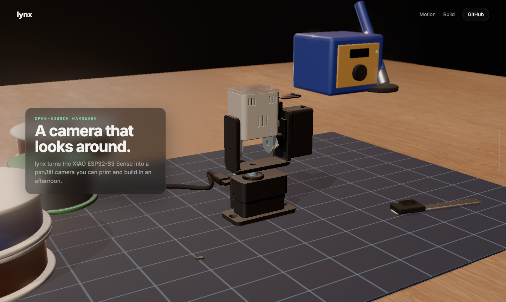
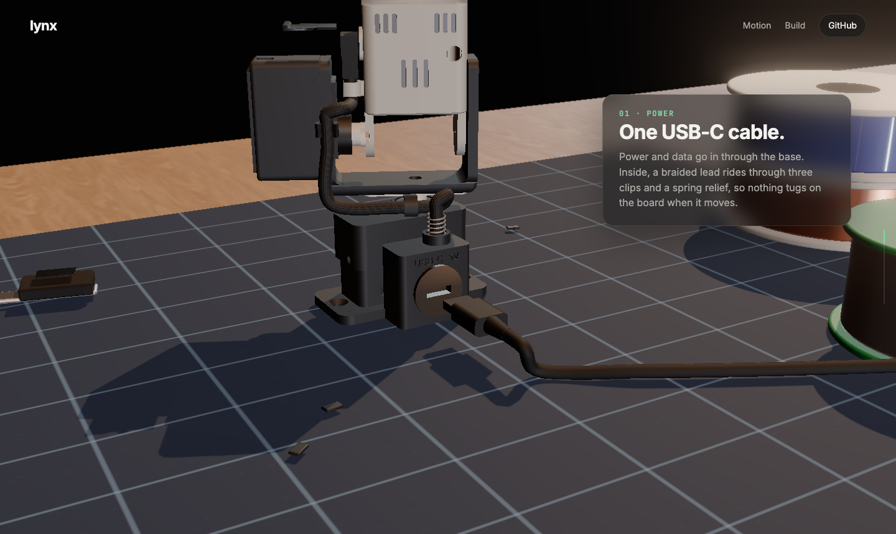
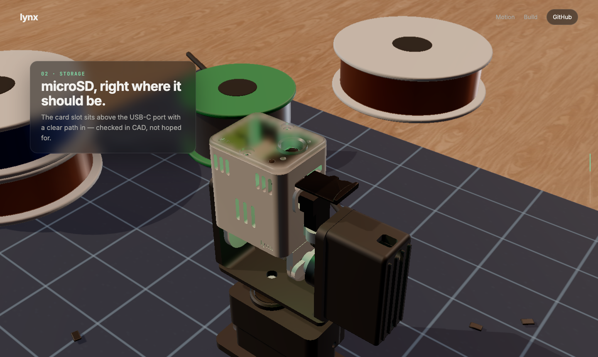
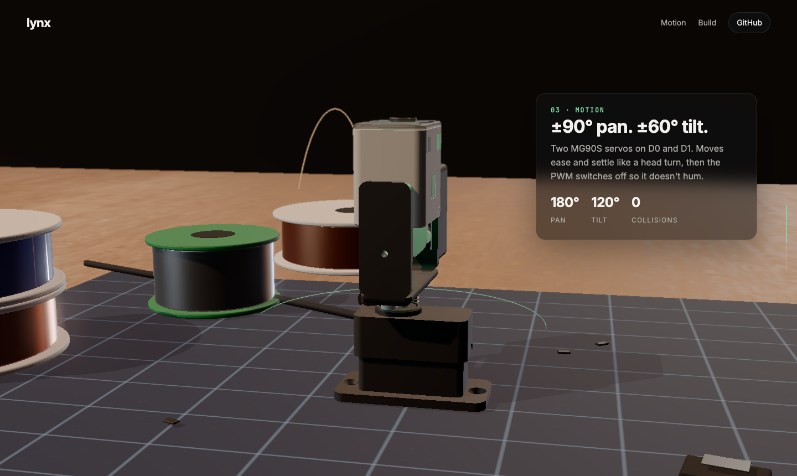
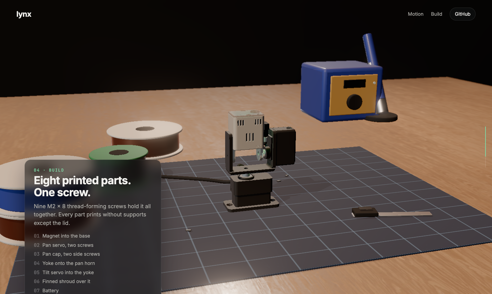
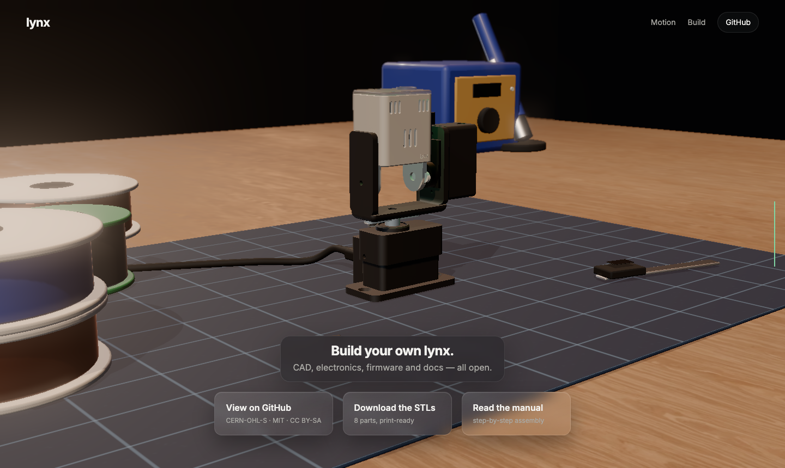

# lynx site

[](https://github.com/alexnodeland/lynx/actions/workflows/pages.yml)
[](package.json)
[](package.json)
[](../LICENSES/MIT.txt)

The landing page at https://alexnodeland.github.io/lynx/: a scroll-driven three.js scene (GSAP for the scroll timeline, n8ao for ambient occlusion) built with Vite.


## Run locally

```sh
npm ci
npm run dev       # dev server
npm run build     # production build into dist/
npm run preview   # serve dist/
```

## Layout

| Path | Contents |
|---|---|
| `index.html` | the landing page |
| `build.html` | the 3D build guide |
| `flash.html` | the web flasher (ESP Web Tools; CI builds `public/flash/lynx.bin` in) |
| `src/stage.js` | the shared scene: renderer, light, set, product rig, cables, post-processing |
| `src/guide.js` | the build guide's steps (what arrives, from where, what you need) |
| `src/build.js` | the build guide: ghosts, fly-ins, framing, orbit, step rail, `#step` links |
| `src/main.js` | the landing page: scroll timeline, shots, chrome |
| `src/materials.js` | materials |
| `src/style.css` | styles |
| `public/assets/` | `lynx.glb` (the model), `set.glb` (the desk set), `rig.json`, `studio_1k.hdr` |
| `public/draco/` | Draco decoder for the compressed glTF |

## Deploy

[`.github/workflows/pages.yml`](../.github/workflows/pages.yml) runs `npm ci && npm run build` and publishes `dist/` to GitHub Pages on every push to `main` that touches `web/`.

## Screens

| | |
|---|---|
|  |  |
|  |  |
|  |  |
