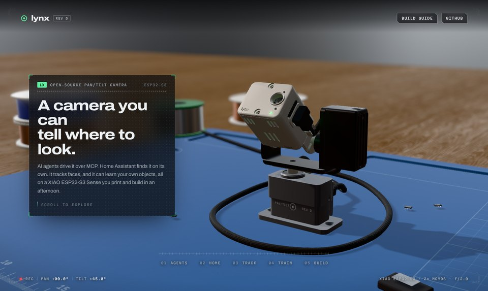
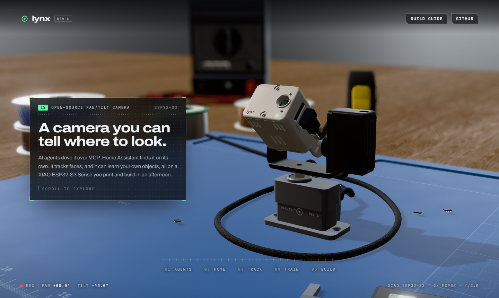
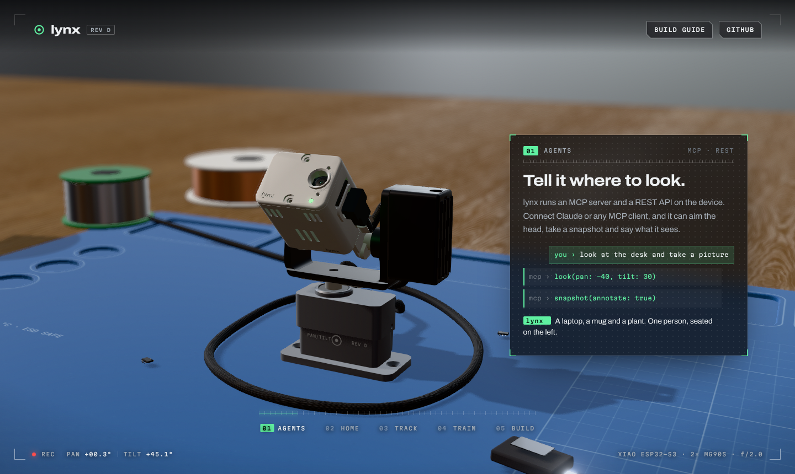
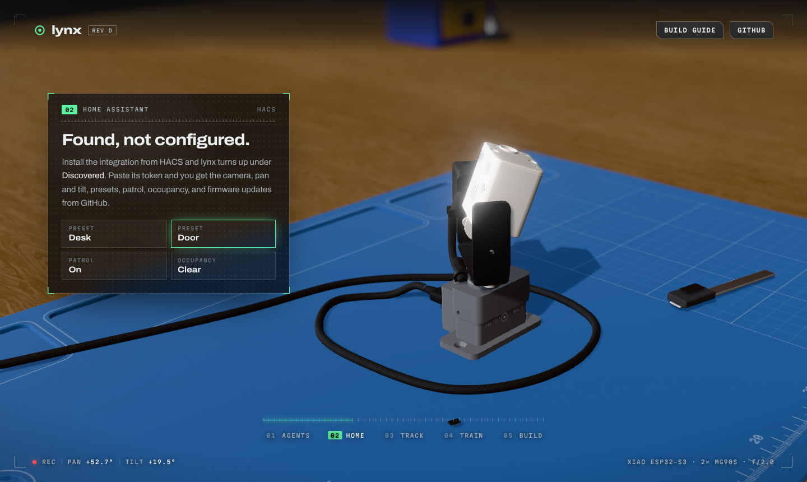
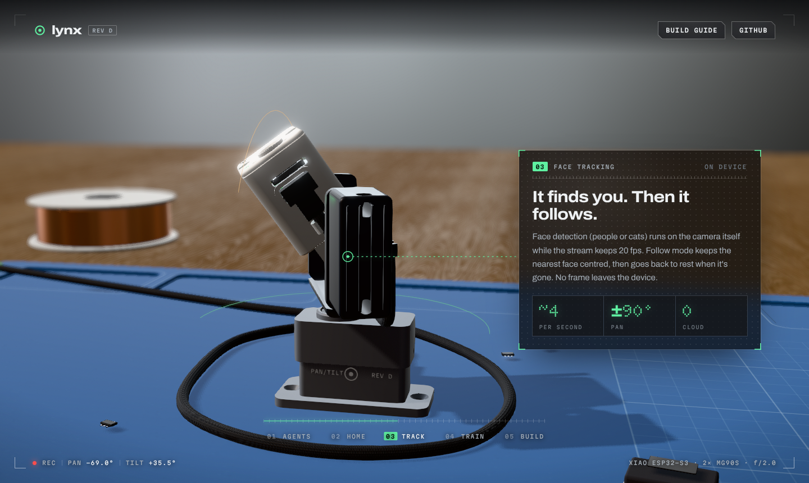
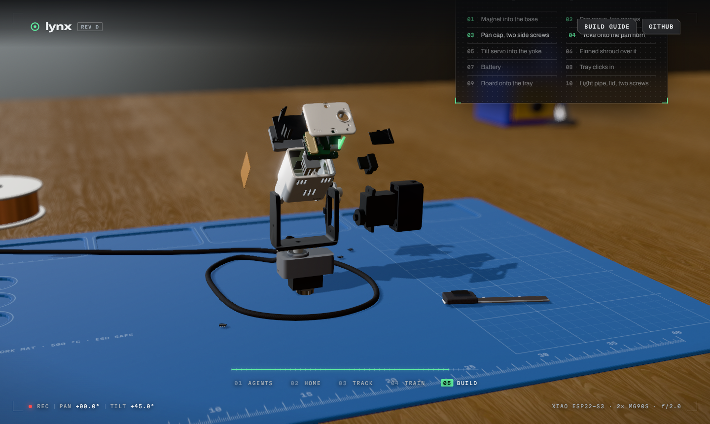
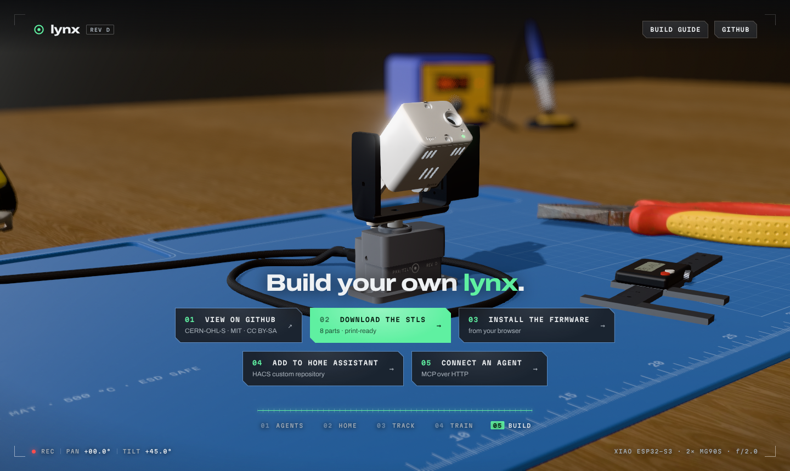

# lynx site

[](https://github.com/alexnodeland/lynx/actions/workflows/pages.yml)
[](package.json)
[](package.json)
[](../LICENSES/MIT.txt)

The landing page at https://alexnodeland.github.io/lynx/: a scroll-driven three.js scene (GSAP for the scroll timeline, n8ao for ambient occlusion) built with Vite.
On desktop the scene is drawn once per frame (the AO pass) and the frame is only redrawn while something on it moves.



## Run locally

```sh
npm ci
npm run dev       # dev server
npm run build     # production build into dist/
npm run preview   # serve dist/
```

After re-exporting `lynx.glb` from Blender, run `npm run optimize-model`: it simplifies every mesh to within
0.05 % of its size (the CAD export is ~5x denser than the screen can show) and re-compresses it with Draco.

## Layout

| Path | Contents |
|---|---|
| `index.html` | the landing page |
| `build.html` | the 3D build guide |
| `flash.html` | the web flasher (ESP Web Tools; CI builds `public/flash/lynx.bin` in) |
| `src/stage.js` | the shared scene: renderer, light, set, product rig, cables, post-processing |
| `src/dof.js` | depth of field: a single gather pass over the AO pass's depth |
| `src/bench.js` | the silicone repair mat, built procedurally |
| `src/guide.js` | the build guide's steps (what arrives, from where, what you need) |
| `src/build.js` | the build guide: ghosts, fly-ins, framing, orbit, step rail, `#step` links |
| `src/main.js` | the landing page: scroll timeline, shots, chrome |
| `src/materials.js` | materials |
| `src/style.css` | styles |
| `public/assets/` | `lynx.glb` (the model), `set.glb` (the desk set), `rig.json`, `workshop_512.hdr` ([Artist Workshop](https://polyhaven.com/a/artist_workshop) from Poly Haven, CC0, halved to 512 px) |
| `public/draco/` | Draco decoder for the compressed glTF |

## Deploy

[`.github/workflows/pages.yml`](../.github/workflows/pages.yml) runs `npm ci && npm run build` and publishes `dist/` to GitHub Pages on every push to `main` that touches `web/`.

## Screens

| | |
|---|---|
|  |  |
|  |  |
|  |  |
